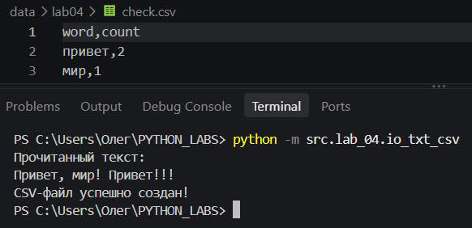
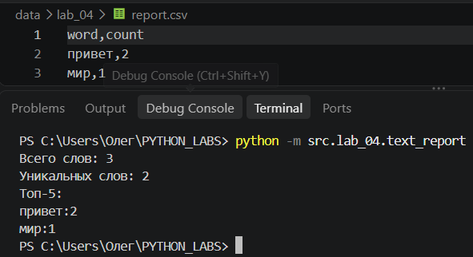
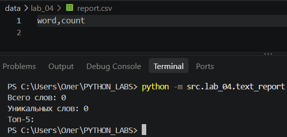
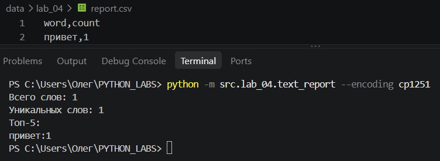
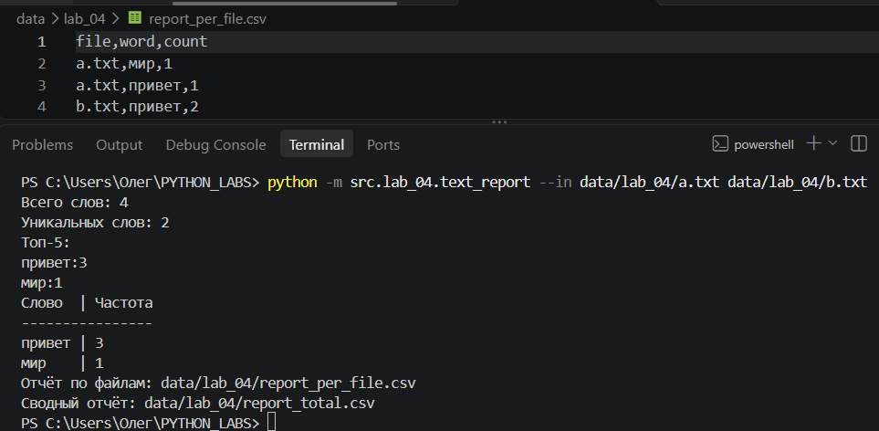

# ЛР4

## Задание A

```python
import csv
from pathlib import Path


def read_text(path: str | Path, encoding: str = "utf-8") -> str:
    """Читает текстовый файл. Для другой кодировки используйте encoding="cp1251"."""
    p = Path(path)
    return p.read_text(encoding=encoding)


def ensure_parent_dir(path: str | Path) -> None:
    """Создаёт родительские папки, если они отсутствуют."""
    p = Path(path)
    p.parent.mkdir(parents=True, exist_ok=True)


def write_csv(
    rows: list[tuple | list],
    path: str | Path,
    header: tuple[str, ...] | None = None
) -> None:
    """Записывает данные в CSV и проверяет одинаковую длину строк."""
    if rows:
        expected_length = len(rows[0])

        for row in rows:
            if len(row) != expected_length:
                raise ValueError("Строки имеют разную длину")

        if header is not None and len(header) != expected_length:
            raise ValueError("Длина заголовка не совпадает с длиной строк")

    ensure_parent_dir(path)

    with Path(path).open("w", newline="", encoding="utf-8") as file:
        writer = csv.writer(file, delimiter=",")

        if header is not None:
            writer.writerow(header)

        writer.writerows(rows)


if __name__ == "__main__":
    txt = read_text("data/lab_04/input.txt")
    print("Прочитанный текст:")
    print(txt)

    write_csv(
        [("word", "count"), ("привет", 2), ("мир", 1)],
        "data/lab_04/check.csv")
    print("CSV создан: data/lab_04/check.csv")
```


## Задание B B*

```python
import argparse
import sys
from collections import Counter
from pathlib import Path

sys.path.insert(0, str(Path(__file__).resolve().parents[1]))

from lib.text import normalize, tokenize, count_freq, top_n
from lab_04.io_txt_csv import read_text, write_csv


def frequencies_from_text(text: str) -> dict[str, int]:
    """Нормализует текст и считает частоты слов."""
    tokens = tokenize(normalize(text))
    return count_freq(tokens)


def sorted_word_counts(freq: dict[str, int]) -> list[tuple[str, int]]:
    """Сортирует слова по частоте, затем по алфавиту."""
    return sorted(freq.items(), key=lambda item: (-item[1], item[0]))


def print_table(freq: dict[str, int]) -> None:
    """Выводит таблицу с подходящей шириной столбцов."""
    rows = sorted_word_counts(freq)

    word_width = max([len("Слово")] + [len(word) for word, _ in rows])
    count_width = max([len("Частота")] + [len(str(count)) for _, count in rows])

    print(f"{'Слово':<{word_width}} | {'Частота':<{count_width}}")
    print("-" * (word_width + count_width + 3))

    for word, count in rows:
        print(f"{word:<{word_width}} | {count:<{count_width}}")


def print_summary(freq: dict[str, int]) -> None:
    """Выводит статистику, топ-5 и таблицу."""
    print(f"Всего слов: {sum(freq.values())}")
    print(f"Уникальных слов: {len(freq)}")
    print("Топ-5:")

    for word, count in top_n(freq, 5):
        print(f"{word}:{count}")

    print_table(freq)


def process_single_file(input_path: str, output_path: str, encoding: str) -> None:
    """Создаёт CSV-отчёт по одному файлу."""
    text = read_text(input_path, encoding=encoding)
    freq = frequencies_from_text(text)

    write_csv(
        sorted_word_counts(freq),
        output_path,
        header=("word", "count")
    )

    print_summary(freq)
    print(f"Отчёт сохранён: {output_path}")


def process_multiple_files(
    input_paths: list[str],
    per_file_path: str,
    total_path: str,
    encoding: str
) -> None:
    """Создаёт отчёт по каждому файлу и общий отчёт."""
    per_file_rows = []
    total_freq = Counter()

    for input_path in input_paths:
        text = read_text(input_path, encoding=encoding)
        freq = frequencies_from_text(text)

        total_freq.update(freq)
        filename = Path(input_path).name

        for word, count in sorted_word_counts(freq):
            per_file_rows.append((filename, word, count))

    per_file_rows.sort(key=lambda row: (row[0], -row[2], row[1]))

    write_csv(
        per_file_rows,
        per_file_path,
        header=("file", "word", "count")
    )

    write_csv(
        sorted_word_counts(total_freq),
        total_path,
        header=("word", "count")
    )

    print_summary(total_freq)
    print(f"Отчёт по файлам: {per_file_path}")
    print(f"Сводный отчёт: {total_path}")


def main() -> None:
    """Обрабатывает аргументы командной строки."""
    parser = argparse.ArgumentParser(description="Отчёт по частоте слов")

    parser.add_argument(
        "--in",
        dest="inputs",
        nargs="+",
        default=["data/lab_04/input.txt"]
    )
    parser.add_argument("--out", default="data/lab_04/report.csv")
    parser.add_argument("--per-file", default="data/lab_04/report_per_file.csv")
    parser.add_argument("--total", default="data/lab_04/report_total.csv")
    parser.add_argument("--encoding", default="utf-8")

    args = parser.parse_args()

    try:
        if len(args.inputs) == 1:
            process_single_file(args.inputs[0], args.out, args.encoding)
        else:
            process_multiple_files(
                args.inputs,
                args.per_file,
                args.total,
                args.encoding
            )
    except (FileNotFoundError, UnicodeDecodeError) as error:
        print(f"Ошибка чтения файла: {error}")
        sys.exit(1)


if __name__ == "__main__":
    main()
```

### Тест 1 — Обычный текст

"""Подсчитывает частоты слов и сохраняет отчёт `report.csv` с заголовком `word,count`."""



### Тест 2 — Пустой файл

"""Обрабатывает пустой текст. В отчёте остаётся только заголовок `word,count`."""



### Тест 3 — Кодировка cp1251

"""Читает входной TXT-файл в кодировке Windows 1251. CSV сохраняется в UTF-8."""



### Тест 4 — Несколько файлов ★

"""Подсчитывает частоты отдельно по каждому файлу и создаёт сводный отчёт."""


## Краевые случаи

### Задание A
- Пустой TXT — возвращается пустая строка.
- Большой TXT — читается целиком, но лучше читать построчно.
- Пустой CSV — создаётся пустой файл или файл только с заголовком.

### Задание B
- Нет файла — программа показывает ошибку.
- Пустой TXT — в CSV остаётся только заголовок.
- Кодировка cp1251 — программа правильно читает русский текст.