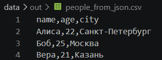
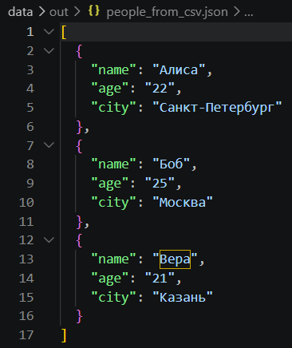
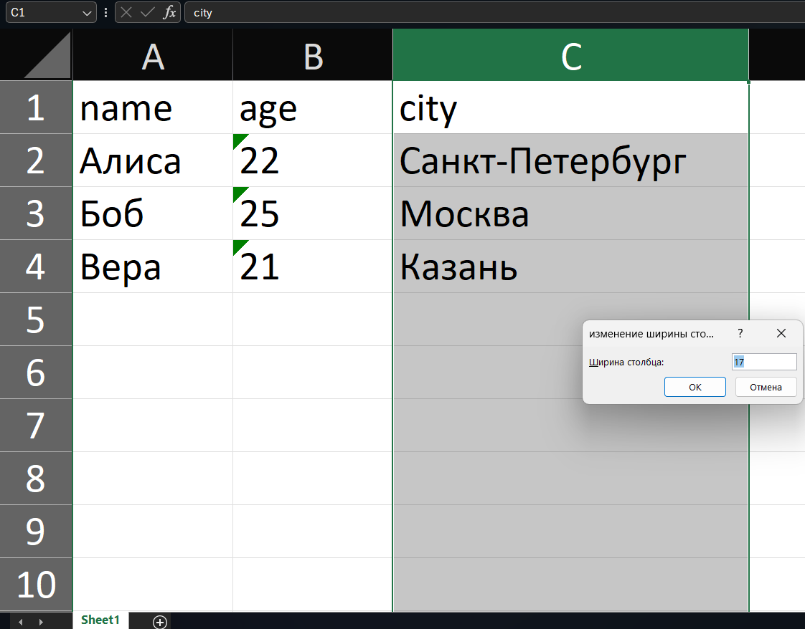

## ЛР5 — JSON и конвертации
### Задание A — JSON ↔ CSV
```python
import csv
import json
from pathlib import Path

def json_to_csv(json_path: str, csv_path: str) -> None:
    """
    Преобразует JSON-файл в CSV.
    Поддерживает список словарей [{...}, {...}], заполняет отсутствующие поля пустыми строками.
    Кодировка UTF-8. Порядок колонок — как в первом объекте или алфавитный (указать в README).
    """
    json_path = Path(json_path)
    csv_path = Path(csv_path)

    if not json_path.is_file():
        raise FileNotFoundError(f"Файл не найден: {json_path}")

    if json_path.suffix.lower() != ".json":
        raise ValueError("Входной файл должен иметь расширение .json")

    if csv_path.suffix.lower() != ".csv":
        raise ValueError("Выходной файл должен иметь расширение .csv")

    with json_path.open(encoding="utf-8") as file:
        try:
            data = json.load(file)
        except json.JSONDecodeError as error:
            raise ValueError(
                "Пустой JSON или неподдерживаемая структура"
            ) from error

    if not isinstance(data, list) or not data:
        raise ValueError("Пустой JSON или неподдерживаемая структура")

    if any(not isinstance(row, dict) for row in data):
        raise ValueError("JSON должен содержать список словарей")

    columns = []

    for row in data:
        for key in row:
            if key not in columns:
                columns.append(key)

    if not columns:
        raise ValueError("Пустой JSON или неподдерживаемая структура")

    if any(not key.strip() for key in columns):
        raise ValueError("Названия столбцов не должны быть пустыми")

    with csv_path.open("w", encoding="utf-8", newline="") as file:
        writer = csv.DictWriter(
            file,
            fieldnames=columns,
            restval=""
        )
        writer.writeheader()
        writer.writerows(data)
def csv_to_json(csv_path: str, json_path: str) -> None:
    """
    Преобразует CSV в JSON (список словарей).
    Заголовок обязателен, значения сохраняются как строки.
    json.dump(..., ensure_ascii=False, indent=2)
    """
    csv_path = Path(csv_path)
    json_path = Path(json_path)

    if not csv_path.is_file():
        raise FileNotFoundError(f"Файл не найден: {csv_path}")

    if csv_path.suffix.lower() != ".csv":
        raise ValueError("Входной файл должен иметь расширение .csv")

    if json_path.suffix.lower() != ".json":
        raise ValueError("Выходной файл должен иметь расширение .json")

    with csv_path.open(encoding="utf-8", newline="") as file:
        try:
            reader = csv.DictReader(file, strict=True)
            columns = reader.fieldnames

            if not columns:
                raise ValueError("Пустой CSV или отсутствует заголовок")

            if any(not name.strip() for name in columns):
                raise ValueError("Названия столбцов не должны быть пустыми")

            if len(columns) != len(set(columns)):
                raise ValueError("Названия столбцов не должны повторяться")

            data = []

            for row in reader:
                if None in row or None in row.values():
                    raise ValueError(
                        "Количество полей не совпадает с заголовком"
                    )

                data.append(row)

        except csv.Error as error:
            raise ValueError("Некорректный формат CSV") from error

    with json_path.open("w", encoding="utf-8") as file:
        json.dump(data, file, ensure_ascii=False, indent=2)
```

#### Результат JSON → CSV



#### Результат CSV → JSON


### Задание B — CSV → XLSX
```python
import csv
from pathlib import Path

from openpyxl import Workbook
from openpyxl.utils import get_column_letter


def csv_to_xlsx(csv_path: str, xlsx_path: str) -> None:
    """
    Конвертирует CSV в XLSX.
    Использовать openpyxl ИЛИ xlsxwriter.
    Первая строка CSV — заголовок.
    Лист называется "Sheet1".
    Колонки — автоширина по длине текста (не менее 8 символов).
    """
    csv_path = Path(csv_path)
    xlsx_path = Path(xlsx_path)

    if not csv_path.is_file():
        raise FileNotFoundError(f"Файл не найден: {csv_path}")

    if csv_path.suffix.lower() != ".csv":
        raise ValueError("Входной файл должен иметь расширение .csv")

    if xlsx_path.suffix.lower() != ".xlsx":
        raise ValueError("Выходной файл должен иметь расширение .xlsx")

    with csv_path.open(encoding="utf-8", newline="") as file:
        try:
            reader = csv.reader(file, strict=True)
            header = next(reader, None)

            if not header:
                raise ValueError("Пустой CSV или отсутствует заголовок")

            if any(not name.strip() for name in header):
                raise ValueError("Названия столбцов не должны быть пустыми")

            if len(header) != len(set(header)):
                raise ValueError("Названия столбцов не должны повторяться")

            rows = [header]

            for row in reader:
                if not row:
                    continue

                if len(row) != len(header):
                    raise ValueError("Количество полей не совпадает с заголовком")

                rows.append(row)

        except csv.Error as error:
            raise ValueError("Некорректный формат CSV") from error

    workbook = Workbook()
    sheet = workbook.active
    sheet.title = "Sheet1"

    for row_number, row in enumerate(rows, start=1):
        for column_number, value in enumerate(row, start=1):
            cell = sheet.cell(
                row=row_number,
                column=column_number,
                value=value)
            cell.data_type = "s"

    for column_number in range(1, len(header) + 1):
        max_length = 0

        for row in rows:
            value = row[column_number - 1]

            for line in value.splitlines():
                max_length = max(max_length, len(line))

        column_letter = get_column_letter(column_number)
        sheet.column_dimensions[column_letter].width = min(
            255, max(8, max_length + 2))
    workbook.save(xlsx_path)
    workbook.close()
```
