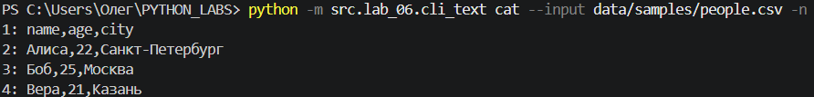
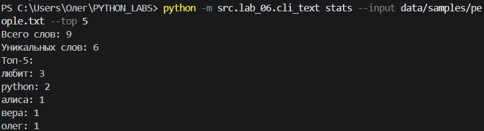
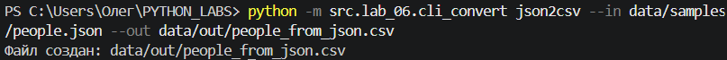
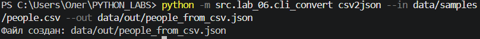
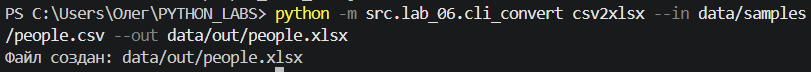
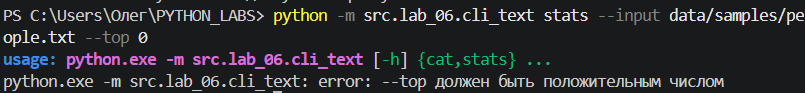

# Лабораторная работа №6
## Задание 1
```python
import argparse
from pathlib import Path

from src.lib.text import normalize, tokenize, count_freq, top_n
def main():
    """
    Обрабатывает аргументы командной строки.

    cat --input <path> [-n] — выводит содержимое файла.
    stats --input <txt> [--top 5] — выводит частоты слов.
    """
    parser = argparse.ArgumentParser(
        description="Вывод файлов и анализ частот слов")
    subparsers = parser.add_subparsers(
        dest="command",
        required=True)

    cat_parser = subparsers.add_parser(
        "cat",
        help="Вывести содержимое файла",
        description="Выводит файл построчно.")
    cat_parser.add_argument(
        "--input",
        required=True,
        help="Путь к входному файлу")
    cat_parser.add_argument(
        "-n",
        action="store_true",
        help="Нумеровать строки")

    stats_parser = subparsers.add_parser(
        "stats",
        help="Показать частоты слов",
        description="Выводит количество слов и наиболее частые слова.")
    stats_parser.add_argument(
        "--input",
        required=True,
        help="Путь к текстовому файлу")
    stats_parser.add_argument(
        "--top",
        type=int,
        default=5,
        help="Количество слов в топе (по умолчанию 5)")

    args = parser.parse_args()

    if args.command == "stats" and args.top <= 0:
        parser.error("--top должен быть положительным числом")

    path = Path(args.input)

    if not path.is_file():
        raise FileNotFoundError(f"Файл не найден: {path}")

    if args.command == "cat":
        with path.open(encoding="utf-8") as file:
            for number, line in enumerate(file, start=1):
                if args.n:
                    print(f"{number}: ", end="")

                print(line, end="")
    elif args.command == "stats":
        with path.open(encoding="utf-8") as file:
            text = file.read()

        tokens = tokenize(normalize(text))
        freq = count_freq(tokens)
        top_words = top_n(freq, n=args.top)

        print(f"Всего слов: {len(tokens)}")
        print(f"Уникальных слов: {len(freq)}")
        print(f"Топ-{args.top}:")

        for word, count in top_words:
            print(f"{word}: {count}")
if __name__ == "__main__":
    main()
```

### Команда cat — вывод файла с нумерацией

```powershell
python -m src.lab_06.cli_text cat --input data/samples/people.csv -n
```

#### Результат



#### Справка cat

```powershell
python -m src.lab_06.cli_text cat --help
```


### Команда stats — анализ частот слов

```powershell
python -m src.lab_06.cli_text stats --input data/samples/people.txt --top 5
```

#### Результат



#### Справка stats

```powershell
python -m src.lab_06.cli_text stats --help
```


## Задание 2 — Конвертация файлов

### Скрипт cli_convert.py

```python
import argparse
from src.lab_05.json_csv import json_to_csv, csv_to_json

def main():
    """
    Обрабатывает аргументы и вызывает функции конвертации из ЛР5.

    json2csv --in <json> --out <csv> — преобразует JSON в CSV.
    csv2json --in <csv> --out <json> — преобразует CSV в JSON.
    csv2xlsx --in <csv> --out <xlsx> — преобразует CSV в XLSX.
    """
    parser = argparse.ArgumentParser(
        description="Конвертация JSON, CSV и XLSX"
    )

    subparsers = parser.add_subparsers(
        dest="command",
        required=True)

    json_parser = subparsers.add_parser(
        "json2csv",
        help="Преобразовать JSON в CSV",
        description="Преобразует список словарей JSON в CSV.")
    json_parser.add_argument(
        "--in",
        dest="input",
        required=True,
        help="Путь к входному JSON-файлу")
    json_parser.add_argument(
        "--out",
        dest="output",
        required=True,
        help="Путь к выходному CSV-файлу")

    csv_parser = subparsers.add_parser(
        "csv2json",
        help="Преобразовать CSV в JSON",
        description="Преобразует CSV с заголовком в JSON.")
    csv_parser.add_argument(
        "--in",
        dest="input",
        required=True,
        help="Путь к входному CSV-файлу")
    csv_parser.add_argument(
        "--out",
        dest="output",
        required=True,
        help="Путь к выходному JSON-файлу")

    xlsx_parser = subparsers.add_parser(
        "csv2xlsx",
        help="Преобразовать CSV в XLSX",
        description="Преобразует CSV в Excel-файл.")
    xlsx_parser.add_argument(
        "--in",
        dest="input",
        required=True,
        help="Путь к входному CSV-файлу")
    xlsx_parser.add_argument(
        "--out",
        dest="output",
        required=True,
        help="Путь к выходному XLSX-файлу")

    args = parser.parse_args()

    try:
        if args.command == "json2csv":
            json_to_csv(args.input, args.output)

        elif args.command == "csv2json":
            csv_to_json(args.input, args.output)

        elif args.command == "csv2xlsx":
            from src.lab_05.csv_xlsx import csv_to_xlsx

            csv_to_xlsx(args.input, args.output)

    except ValueError as error:
        parser.error(str(error))

    print(f"Файл создан: {args.output}")
if __name__ == "__main__":
    main()
```

### Команда json2csv — JSON → CSV

```powershell
python -m src.lab_06.cli_convert json2csv --in data/samples/people.json --out data/out/people_from_json.csv
```

#### Результат



[Полученный CSV-файл](../../data/out/people_from_json.csv)

#### Справка json2csv

```powershell
python -m src.lab_06.cli_convert json2csv --help
```


### Команда csv2json — CSV → JSON

```powershell
python -m src.lab_06.cli_convert csv2json --in data/samples/people.csv --out data/out/people_from_csv.json
```

#### Результат



[Полученный JSON-файл](../../data/out/people_from_csv.json)

#### Справка csv2json

```powershell
python -m src.lab_06.cli_convert csv2json --help
```


### Команда csv2xlsx — CSV → XLSX

```powershell
python -m src.lab_06.cli_convert csv2xlsx --in data/samples/people.csv --out data/out/people.xlsx
```

#### Результат



[Полученный XLSX-файл](../../data/out/people.xlsx)

#### Справка csv2xlsx

```powershell
python -m src.lab_06.cli_convert csv2xlsx --help
```


## Параметры и запуск

Все команды выполняются из корня PYTHON_LABS.
Папка data/out должна существовать. Кодировка текстовых файлов — UTF-8.

| Параметр | Назначение |
|---|---|
| `--input` | Обязательный путь к файлу для cat и stats |
| `-n` | Включает нумерацию строк в cat |
| `--top` | Количество слов в stats; положительное целое число, по умолчанию 5 |
| `--in` | Обязательный путь к исходному файлу конвертации |
| `--out` | Обязательный путь к файлу результата |
| `--help` | Показывает справку и завершает работу |

Анализ текста использует функции ЛР3 из src/lib/text.py.
Конвертеры вызывают функции ЛР5.
Для создания XLSX требуется установленная зависимость openpyxl из ЛР5.

## Проверка ошибок

### Неверное значение --top

```powershell
python -m src.lab_06.cli_text stats --input data/samples/people.txt --top 0
```

Ожидаемый результат: сообщение argparse
«--top должен быть положительным числом».

Полученный результат соответствует ожидаемому.



### Отсутствующий входной файл

```powershell
python -m src.lab_06.cli_text cat --input data/samples/missing.txt
```

Ожидаемый результат: FileNotFoundError с сообщением
«Файл не найден».

Полученный результат соответствует ожидаемому.

