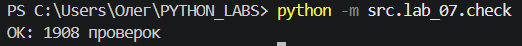
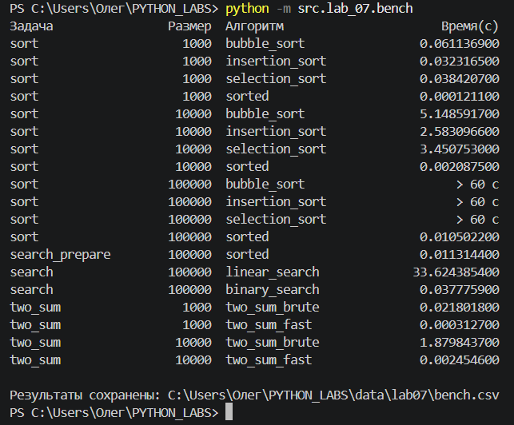
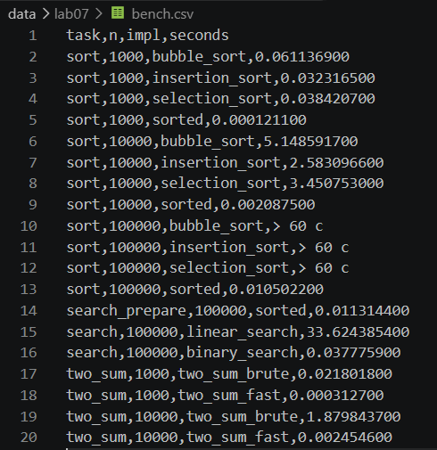

# ЛР7 — Поиск, сортировка и измерение времени

## search.py

```python
def linear_search(nums, x) -> int:
    """Возвращает индекс первого вхождения x или -1."""
    for i, value in enumerate(nums):
        if value == x:
            return i
    return -1

def binary_search(sorted_nums, x) -> int:
    """Возвращает индекс любого вхождения x или -1.
    Список должен быть отсортирован по возрастанию.
    На неотсортированном списке результат не определён.
    """
    lo = 0
    hi = len(sorted_nums) - 1
    while lo <= hi:
        mid = (lo + hi) // 2
        if sorted_nums[mid] == x:
            return mid
        if sorted_nums[mid] < x:
            lo = mid + 1
        else:
            hi = mid - 1
    return -1

def two_sum_brute(nums, target) -> tuple[int, int] | None:
    """Перебирает пары и возвращает индексы i < j с суммой target.
    Если подходящей пары нет, возвращает None.
    """
    for i in range(len(nums)):
        for j in range(i + 1, len(nums)):
            if nums[i] + nums[j] == target:
                return i, j
    return None

def two_sum_fast(nums, target) -> tuple[int, int] | None:
    """Находит пару с суммой target за один проход со словарём.

    Возвращает индексы i < j или None, если решения нет.
    """
    seen = {}
    for j, value in enumerate(nums):
        needed = target - value
        if needed in seen:
            return seen[needed], j
        seen[value] = j
    return None
```

## sorting.py

```python
def bubble_sort(nums) -> list:
    """Сортирует пузырьком, не изменяя исходный список.
    Если за проход не было обменов, завершает работу досрочно.
    """
    for _ in range(len(nums) - 1):
        swapped = False
        for i in range(len(nums) - 1):
            if nums[i] > nums[i + 1]:
                nums[i], nums[i + 1] = nums[i + 1], nums[i]
                swapped = True
        if not swapped:
            break


def insertion_sort(nums) -> list:
    """Сортирует вставками, возвращая новый список."""
    nums = list(nums)
    for i in range(1, len(nums)):
        value = nums[i]
        j = i - 1
        while j >= 0 and nums[j] > value:
            nums[j + 1] = nums[j]
            j -= 1
        nums[j + 1] = value
    return nums

def selection_sort(nums) -> list:
    """Сортирует выбором, возвращая новый список."""
    nums = list(nums)
    for i in range(len(nums) - 1):
        smallest = i
        for j in range(i + 1, len(nums)):
            if nums[j] < nums[smallest]:
                smallest = j
        nums[i], nums[smallest] = nums[smallest], nums[i]
    return nums
```

## check.py

```python
import random
from src.lab_07.search import (
    linear_search,
    binary_search,
    two_sum_brute,
    two_sum_fast,)
from src.lab_07.sorting import (
    bubble_sort,
    insertion_sort,
    selection_sort,)

checks = 0
FIXED_LISTS = [
    [],
    [5],
    [2, 1],
    [1, 2],
    [2, 2, 2],
    [-3, 0, -3, 2],]

def random_list():
    """Создаёт случайный список длиной 0–50 со значениями -100–100."""
    n = random.randint(0, 50)
    return [random.randint(-100, 100) for _ in range(n)]

def check_sorting(fn, trials=100) -> None:
    """Сравнивает сортировку с sorted и проверяет неизменность входа."""
    global checks

    cases = [list(nums) for nums in FIXED_LISTS]
    cases += [random_list() for _ in range(trials)]

    for nums in cases:
        original = list(nums)
        result = fn(nums)

        message = (
            f"{fn.__name__}: "
            f"исходный={original}, результат={result}")

        assert result == sorted(original), message
        assert nums == original, f"Изменён исходный список: {message}"
        assert isinstance(result, list), f"Результат не список: {message}"
        assert result is not nums, f"Возвращён исходный список: {message}"

        checks += 1

def index_or_minus_one(nums, x):
    """Возвращает результат list.index или -1 при отсутствии x."""
    try:
        return nums.index(x)
    except ValueError:
        return -1

def check_search() -> None:
    """Проверяет оба поиска на случайных и граничных случаях."""
    global checks

    cases = [list(nums) for nums in FIXED_LISTS]
    cases += [random_list() for _ in range(100)]

    for nums in cases:
        ordered = sorted(nums)

        queries = [
            -101,
            101,
            random.randint(-100, 100),
            random.randint(-100, 100),]
        if ordered:
            queries += [ordered[0], ordered[-1]]
        else:
            queries += [0, 1]
        for x in queries:
            expected = index_or_minus_one(nums, x)
            actual = linear_search(nums, x)
            assert actual == expected, (
                f"linear_search: nums={nums}, x={x}, "
                f"ожидалось={expected}, получено={actual}")
            checks += 1

            expected = index_or_minus_one(ordered, x)
            actual = binary_search(ordered, x)

            if expected == -1:
                valid = actual == -1
            else:
                valid = (
                    0 <= actual < len(ordered)
                    and ordered[actual] == x)
            assert valid, (
                f"binary_search: nums={ordered}, x={x}, "
                f"получено={actual}, первое вхождение={expected}")
            checks += 1
def check_two_sum(trials=100) -> None:
    """Проверяет существование решения и корректность обеих пар."""
    global checks
    cases = [
        ([], 0),
        ([1], 2),
        ([3, 3], 6),
        ([1, 2], 10),
        ([-3, 1, 2, 5], 2),
        ([1, 2, 3, 4], 5),]

    for trial in range(trials):
        nums = random_list()
        target = random.randint(-200, 200)

        # В части случаев специально обеспечиваем существование пары.
        if trial % 2 == 0 and len(nums) >= 2:
            i, j = random.sample(range(len(nums)), 2)
            target = nums[i] + nums[j]

        cases.append((nums, target))
    for nums, target in cases:
        brute = two_sum_brute(nums, target)
        fast = two_sum_fast(nums, target)
        message = (
            f"nums={nums}, target={target}, "
            f"brute={brute}, fast={fast}")
        exists = any(
            nums[i] + nums[j] == target
            for i in range(len(nums))
            for j in range(i + 1, len(nums)))
        assert (brute is not None) == exists, message
        assert (fast is not None) == exists, message
        for pair in (brute, fast):
            if pair is not None:
                assert isinstance(pair, tuple) and len(pair) == 2, message
                i, j = pair
                assert 0 <= i < j < len(nums), message
                assert nums[i] + nums[j] == target, message
        checks += 1

def main():
    """Запускает все проверки и печатает их количество."""
    global checks
    checks = 0
    random.seed(42)
    for fn in (bubble_sort, insertion_sort, selection_sort):
        check_sorting(fn)
    check_search()
    check_two_sum()
    print(f"OK: {checks} проверок")
if __name__ == "__main__":
    main()
```




## bench.py

```python
import multiprocessing as mp
from pathlib import Path
import random
import timeit
from src.lab_04.io_txt_csv import write_csv
from src.lab_07.search import linear_search, binary_search, two_sum_brute, two_sum_fast
from src.lab_07.sorting import bubble_sort, insertion_sort, selection_sort

ROOT = Path(__file__).resolve().parents[2]
CSV_PATH = ROOT / "data" / "lab07" / "bench.csv"
TIME_LIMIT = 60

def sort_worker(fn, data, connection):
    """Измеряет сортировку в отдельном процессе."""
    try:
        connection.send(("ready", None))
        seconds = timeit.timeit(lambda: fn(data), number=1)
        connection.send(("ok", seconds))
    except Exception as error:
        connection.send(("error", repr(error)))
    finally:
        connection.close()

def timed_sort(fn, data):
    """Возвращает время сортировки или отметку о превышении лимита."""
    context = mp.get_context("spawn")
    receiver, sender = context.Pipe(duplex=False)
    process = context.Process(target=sort_worker, args=(fn, data, sender))
    process.start()
    sender.close()
    try:
        if not receiver.poll(30):
            raise RuntimeError("Не удалось запустить процесс сортировки")
        status, value = receiver.recv()
        if status != "ready":
            raise RuntimeError(value)
        if receiver.poll(TIME_LIMIT):
            status, value = receiver.recv()
            if status == "ok":
                return value
            raise RuntimeError(value)
        return f"> {TIME_LIMIT} с"
    finally:
        if process.is_alive():
            process.terminate()
        process.join()
        receiver.close()

def save_result(rows, task, n, impl, seconds):
    """Выводит результат и сохраняет CSV."""
    value = f"{seconds:.9f}" if isinstance(seconds, float) else seconds
    rows.append((task, n, impl, value))
    print(f"{task:<18}  {n:>8}  {impl:<20}  {value:>16}", flush=True)
    CSV_PATH.parent.mkdir(parents=True, exist_ok=True)
    write_csv(rows, CSV_PATH, header=("task", "n", "impl", "seconds"))

def bench_sorts(rows):
    """Сравнивает сортировки на одинаковых случайных данных."""
    for n in (1_000, 10_000, 100_000):
        data = [random.randint(-100_000, 100_000) for _ in range(n)]
        for fn in (bubble_sort, insertion_sort, selection_sort, sorted):
            if n == 100_000 and fn in (bubble_sort, insertion_sort, selection_sort):
                seconds = timed_sort(fn, data)
            else:
                seconds = timeit.timeit(lambda: fn(data), number=1)
            save_result(rows, "sort", n, fn.__name__, seconds)

def run_queries(fn, nums, queries):
    """Выполняет все поисковые запросы."""
    for x in queries:
        fn(nums, x)

def bench_search(rows):
    """Сравнивает 10 000 запросов и отдельно измеряет сортировку."""
    n = 100_000
    data = [random.randint(-100_000, 100_000) for _ in range(n)]
    queries = [random.randint(-100_000, 100_000) for _ in range(10_000)]
    seconds = timeit.timeit(lambda: sorted(data), number=1)
    save_result(rows, "search_prepare", n, "sorted", seconds)
    ordered = sorted(data)
    for fn, nums in ((linear_search, data), (binary_search, ordered)):
        seconds = timeit.timeit(lambda: run_queries(fn, nums, queries), number=1)
        save_result(rows, "search", n, fn.__name__, seconds)

def bench_two_sum(rows):
    """Сравнивает Two Sum на данных с единственной парой в конце."""
    for n in (1_000, 10_000):
        data = [random.randint(1, 100_000) for _ in range(n - 2)]
        data += [-1, -2]
        target = -3
        for fn in (two_sum_brute, two_sum_fast):
            seconds = timeit.timeit(lambda: fn(data, target), number=1)
            save_result(rows, "two_sum", n, fn.__name__, seconds)

def main():
    """Запускает обязательные замеры."""
    random.seed(42)
    rows = []
    print(f"{'Задача':<18}  {'Размер':>8}  {'Алгоритм':<20}  {'Время(с)':>16}", flush=True)
    bench_sorts(rows)
    bench_search(rows)
    bench_two_sum(rows)
    print(f"\nРезультаты сохранены: {CSV_PATH}")

if __name__ == "__main__":
    main()
```



## Выводы

Пузырёк имеет сложность O(n²): если элементов становится
в 10 раз больше, работы становится примерно в 100 раз больше.
В моих замерах время выросло примерно в 84 раза.
У sorted сложность O(n log n), поэтому он замедляется намного
меньше: ожидается рост примерно в 12–13 раз, у меня получилось
в 17 раз. Точные времена зависят от данных и нагрузки компьютера.

Бинарный поиск требует отсортированного списка, иначе он может
не найти существующий элемент. Для одного запроса обычно проще
использовать линейный поиск. Если запросов много, сортировка
окупается. У меня 10 000 линейных запросов заняли 33,62 с,
а бинарных вместе с предварительной сортировкой — около 0,049 с.

## Проверки

check.py выполнил 1908 проверок и вывел OK.
В итоговом запуске расхождений с эталоном не найдено.
При подготовке исправлены ошибки отступов и импортов.